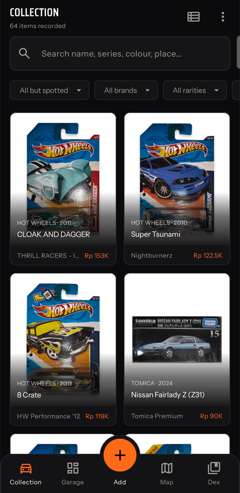
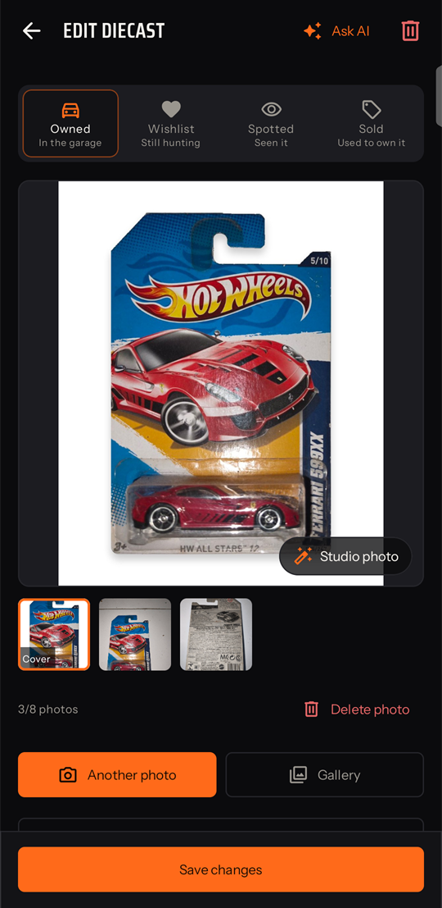
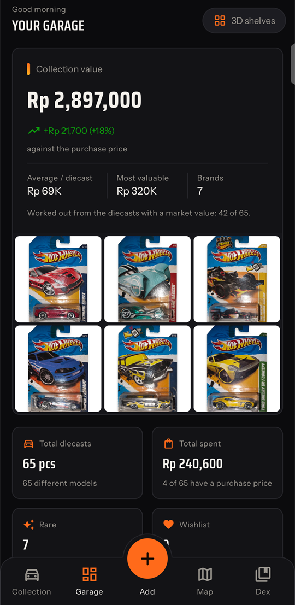
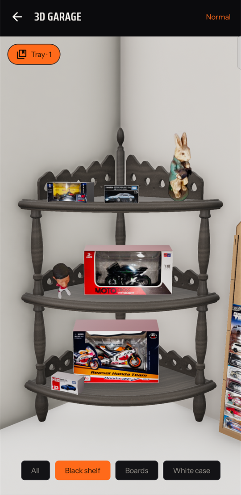
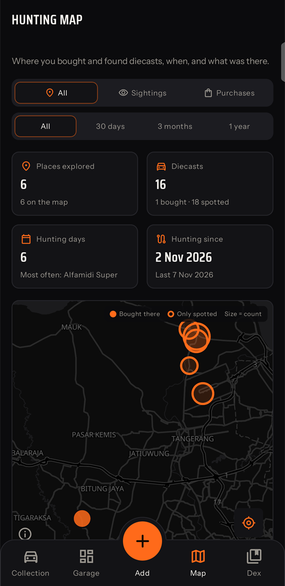
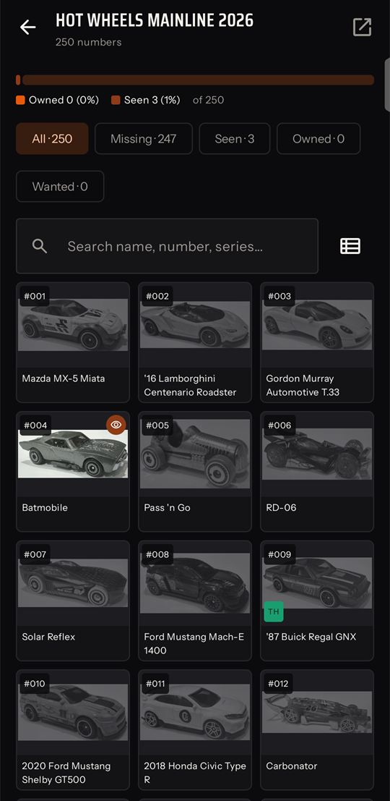

<div align="center">


# Diecast Tracker

**A private, offline-first Android app for die-cast car collectors.**<br>
Photograph your cars, let a free AI read the cards, tick off the Hot Wheels, Matchbox, Mini GT and Tomica checklists,
map where you hunt, check market prices, and see your collection on a 3D model of your shelves.

[](https://github.com/caropeboka/diecast-tracker-android/releases/latest)
[](https://github.com/caropeboka/diecast-tracker-android/releases)
[](LICENSE)


[**⬇ Download the APK**](https://github.com/caropeboka/diecast-tracker-android/releases/latest/download/diecast-tracker.apk)
· [Install guide](#download-and-install) · [Features](#features) · [Changelog](CHANGELOG.md)

English · Bahasa Indonesia · 简体中文

</div>

<table>
  <tr>
    <td></td>
    <td></td>
    <td></td>
  </tr>
  <tr>
    <td></td>
    <td></td>
    <td></td>
  </tr>
</table>

## Contents

- [Why](#why)
- [Features](#features)
- [Download and install](#download-and-install)
- [Getting started](#getting-started)
- [Setting up the AI](#setting-up-the-ai)
- [Privacy](#privacy)
- [Building from source](#building-from-source)
- [Architecture](#architecture)
- [Contributing](#contributing)
- [Roadmap](#roadmap)
- [License and credits](#license-and-credits)

## Why

Spreadsheets don't show a card's photo, and collection apps want an account and a subscription. Diecast Tracker
keeps everything on the phone: no server, no sign-up, no ads, no tracking. It goes online only for what needs the
internet (the AI you set up, the wiki checklists, map tiles, place names and exchange rates), and it works on the
store floor with a poor connection.

It started as a Laravel + React web app for one collector and was rewritten natively for Android, so it runs on the
phone only when opened. The web app's logic and feature tests were ported over, so both behave the same and restore
each other's backups.

## Features

### 📦 Collection
- A grid or list with search (tags included), filters for status, brand, rarity, tag and missing data, and 7 sort
  orders.
- Up to 8 photos per car from the camera or the gallery; the first one is the cover.
- Owned, wishlist, spotted and sold, with packaging, condition, scale, prices, storage location and tags.
- **Studio photo:** turns a photo into a clean cover on white, entirely on the phone. Loose cars are cut out with
  ML Kit; for cards and boxes you place four corners and the app squares the card up, rounds its corners and clears
  the hang hole.

### ✨ AI that you bring yourself
- **Scan:** shoot every side of the card, tap "Scan with AI", and the name, brand, series, number, year and rarity are
  filled in. Fields the AI filled are marked ✦, and a car you already own raises a duplicate warning.
- **Ask AI:** a chat on every car's page that sees its photos and details. It answers questions (release year, TH or
  STH, versions) and suggests changes you apply with one tap. With Gemini it searches the web and lists its sources.
- **Nine free providers** and any OpenAI-compatible server, tried in your order. When one runs out of quota, is busy,
  is too slow or rejects its key, the same request goes straight to the next. See [Setting up the AI](#setting-up-the-ai).
- Every AI request shows its steps as a live log (uploading, waiting, switching provider) instead of a bare spinner.

### 🛒 Out hunting
- **Store check:** photograph a card on the shelf and see at once whether you own it, want it or saw it before.
  Then +1, "Got it" (bought here, today), log the sighting with the shelf price, or add it. Shoot several in a row and
  they are read one by one. Without the AI, type a name: that works offline. Opens from a launcher shortcut too.
- **Bulk scan:** queue many photos and the AI reads them in the background, even with the app closed. It waits out
  quota limits and lost connections; you review the results and save the confident ones in one tap.
- **Sightings and the hunting map:** every sighting has a place, date, price and photo. The map shows where you bought
  or only saw cars, with stats, a day-by-day history, and a chart by province, city, district and village that
  narrows the page to an area.

### 📖 Dex (checklists)
- Release lists synced from the fan wikis: **Hot Wheels** mainline from 1989, **Matchbox** from 2000, **Mini GT**
  (with Kaido House) 2018–2022, the **Tomica** regular lineup and **Tomica Premium** per release year.
- The collection is linked to the lists automatically, across years: a card's printed year is often the casting's
  copyright year, not the release year. Wrong links can be redone from a search of every list.
- Seen / caught / wanted progress per brand, year and series, with a page per brand.
- Your own lists for any other line: by hand with photos, from Excel or CSV, from checklist screenshots read by the
  AI, looked up on the web by the AI (reviewed before they're added), or built from your collection.

### 💰 Prices and stats
- **Market price check:** screenshots of Tokopedia, Shopee, Lazada, Google Shopping, Facebook, OLX, Carousell, or
  sold listings on eBay, Yahoo! Auctions Japan or Mercari Japan, and Google Lens for a car its name doesn't find; the AI
  reads every listing, outliers are dropped, and you get the median, a fair range, a suggested price and how much to
  trust it. Prices abroad are converted at the day's rate. Also a rough AI estimate from the web, and what you paid
  for look-alikes before.
- **Garage dashboard:** the collection's value and gain, the most valuable cars, Dex progress, and breakdowns by
  brand, rarity, car manufacturer, release year and scale. Every number opens the cars behind it.

### 🧱 3D garage
- Real furniture modelled in code after photos: a carved corner shelf, two laser-cut blister boards on the wall, a
  low desk under them with two car lifts, and a 6 × 10 case, rendered with Filament.
- Owned cars appear as their photos: cards hang on the boards, loose cars sit in the compartments, on the lifts or
  anywhere on the desk. Place them anywhere they fit (that fills in their storage location); the rest wait in a
  tray, or "Place all automatically". How many cards a lane takes is yours to set.
- A map-like camera, cars that glide between places, and decorations: photograph a figure and the app cuts it out (and
  can clean off the dust) to stand on the shelf.

### 🌐 Languages, currency, backup
- English, Bahasa Indonesia and Simplified Chinese, following the phone or chosen in Settings.
- Prices in Rupiah, US dollars or Chinese yuan at the day's exchange rate (always stored in Rupiah); a choice of date
  formats.
- A guided tour on first launch that spotlights each part of the app on the real screens.
- One `.zip` backup with every photo, the Dex, price checks, shelf places and decorations, saved through the file
  picker or shared. Restores phone and web backups (merge or replace). Excel export. A reminder after 30 days.

## Download and install

**Requirements:** Android 10 or newer, a 64-bit ARM phone (`arm64-v8a`, nearly every phone from the last years) and
Google Play services (location and the on-device cut-out model).

1. On the phone, open the [latest release](https://github.com/caropeboka/diecast-tracker-android/releases/latest) and
   download **`diecast-tracker.apk`**.
2. Open the downloaded file. If Android asks, allow your browser or file manager to **install unknown apps**.
3. Tap **Install**, then **Open**. The tour starts with the language.

**Updating:** download the new APK and install it over the old one. Your collection stays: every release is signed
with the same key.

<details>
<summary><b>Check that the APK is genuine</b></summary>

Each release lists the APK's SHA-256 checksum. The signing certificate's SHA-256 fingerprint is:

```
15:DE:A3:46:F2:9F:6A:79:98:41:E7:B1:45:DD:0C:F9:17:61:3B:F2:01:6C:E3:80:4D:C3:07:4F:47:EB:C1:0B
```

Check it with the Android SDK's `apksigner verify --print-certs diecast-tracker.apk`, or with an app such as
App Manager on the phone.
</details>

<details>
<summary><b>Android's developer verification</b></summary>

Since 30 September 2026, certified Android devices in Brazil, Indonesia, Singapore and Thailand only install apps
from verified developers **when they come from participating app stores**. An APK downloaded straight from a
website, like this one, installs as before. Google plans to extend verification to all apps in 2027
([Google's FAQ](https://developer.android.com/developer-verification/guides/faq)). If your phone ever refuses the APK
because its developer isn't verified, either turn on Android's one-time "advanced flow" (developer options, a
restart and a one-day wait) or install it from a computer with `adb install diecast-tracker.apk`.
</details>

The release APK contains no trademarked artwork: the blister boards show a drawn flame instead of a brand logo.

## Getting started

1. **Pick a language** on the first screen of the tour (change it later in **⚙ Settings → General**).
2. **Add a car:** tap the orange **＋** → *Scan with AI* or *Fill in by hand* (*Bulk scan* and *Store check* are
   there too). Shoot the front and the back of the card; the camera reopens after each shot.
3. **Set up an AI** (optional, free): **⚙ Settings → AI**, see below. Everything else works without it.
4. **Sync the Dex:** open the **Dex** tab, pick a brand and the years you collect, and sync. Your cars are linked
   to the lists as soon as it finishes.
5. **Coming from the web app?** **⚙ Settings → Data & backup → Restore from a backup** takes the web app's backup zip.

## Setting up the AI

Every provider below has a free tier. Create a key, then open **⚙ Settings → AI**, paste it and tap **Test key** to
check it and choose a model. Use ↑ / ↓ to set the order they're tried in; one that's out of quota rests until its
quota is back.

| Provider | Free tier (checked November 2026) | Get a key |
| --- | --- | --- |
| Google Gemini | a daily quota; the only one that can search the web | [aistudio.google.com](https://aistudio.google.com/apikey) |
| Groq | very fast, about 1,000 requests a day, 2 photos per request | [console.groq.com](https://console.groq.com/keys) |
| Mistral | "Experiment" plan (phone check; photos may be used for training) | [console.mistral.ai](https://console.mistral.ai/api-keys) |
| OpenRouter | free models: 50 requests a day (1,000 after a one-time $10 top-up) | [openrouter.ai](https://openrouter.ai/keys) |
| Cloudflare Workers AI | 10,000 neurons a day; needs your account ID too | [dash.cloudflare.com](https://dash.cloudflare.com/profile/api-tokens) |
| NVIDIA NIM | free for trying out, about 40 requests a minute | [build.nvidia.com](https://build.nvidia.com/settings/api-keys) |
| Z.ai | GLM-4.6V-Flash, free, one request at a time | [z.ai](https://z.ai/manage-apikey/apikey-list) |
| OVHcloud AI Endpoints | no account and no key, about 2 requests a minute; off until switched on | — |
| OpenAI-compatible | any server that speaks the OpenAI API, e.g. LM Studio on your network | — |

Free tiers change often. The settings screen notes each provider's terms.

## Privacy

- **No backend, no account, no analytics, no ads.** The collection and its photos live in the app's private storage.
- Photos go to an AI provider **only when you ask the AI** (scan, store check, bulk scan, Ask AI, price check), and
  only to the providers you set up. Price-check screenshots are read and then discarded.
- Other network use: the fan wikis on Fandom for the Dex; OpenStreetMap's [Nominatim](https://nominatim.org) for
  place names and regions; [OpenFreeMap](https://openfreemap.org) for map tiles; Google Play services for location
  and the ML Kit model download; and, only when prices are shown in another currency or a listing abroad is
  converted, [Frankfurter](https://frankfurter.dev) or [open.er-api.com](https://open.er-api.com) for exchange rates.
- API keys are stored on the phone and excluded from Android's cloud backup.
- Backups are files you save or share yourself; nothing is uploaded automatically.

## Building from source

You need Android Studio with JDK 21 or newer and the Android SDK with platform 37.

```sh
git clone https://github.com/caropeboka/diecast-tracker-android.git
cd diecast-tracker-android
./gradlew :app:assembleDebug        # debug APK (arm64 + x86_64 for the emulator)
./gradlew :app:testDebugUnitTest    # JVM and Robolectric tests
./gradlew :app:lintDebug
./gradlew :app:assembleRelease      # R8-minified release APK (arm64 only)
```

**Release signing:** put a `signing.properties` file in the project root (it is git-ignored):

```properties
storeFile=/path/to/your.jks
storePassword=…
keyAlias=…
keyPassword=…
```

Without it, the release build is signed with your local debug key. Choose one key and keep it: an update signed with
another key can't be installed over the old app without uninstalling it, which deletes its data.

**Brand logo (optional):** the blister boards show `app/src/main/assets/brand/hot_wheels_logo.png` if it exists. The
logo is Mattel's trademark, so it isn't in the repository; without it the boards draw a flame.

## Architecture

A single-module, single-activity app in Kotlin and Jetpack Compose. Logic lives in plain Kotlin classes in `data/`,
most of them pure functions over Room rows, so they are tested on the JVM. The screens in `ui/` are Compose with a
view model each, and navigation uses type-safe routes.

| Area | Libraries |
| --- | --- |
| UI | Jetpack Compose (Material 3), Navigation Compose, shared-element and container transitions |
| Data | Room (schema v8, every version migrated, schemas in `app/schemas`), DataStore |
| Network | OkHttp 5, kotlinx.serialization |
| Images | Coil 3, ML Kit subject segmentation (on the device) |
| Maps and location | MapLibre Android with OpenFreeMap, Fused Location Provider |
| Background work | WorkManager (Dex sync, thumbnails, bulk scan) |
| 3D | SceneView 4 on Filament; the furniture is built from code, no model files |

```
app/src/main/java/io/github/caropeboka/diecasttracker/
├── data/            entities, DAOs, repositories and the app's logic
│   ├── ai/          Gemini and OpenAI-style clients, provider switching, scanner, chat
│   ├── backup/      backup zip export and restore, Excel
│   ├── dashboard/   the Garage dashboard's figures
│   ├── decor/       decorations for the 3D shelf
│   ├── dex/         wiki parsing, sync, matching, progress, own lists
│   ├── explore/     the hunting map's grouping, stats and regions
│   ├── locale/      app language and texts outside the screens
│   ├── money/       exchange rates
│   ├── places/      place names (Nominatim) and regions
│   ├── price/       market price analysis
│   ├── scan/        bulk scan queue and in-store check
│   ├── shelf/       3D garage placement
│   └── studio/      studio photos on the phone
├── ui/              Compose screens per feature (collection, edit, dex, garage, check, explore, …)
└── util/            money and date formats
```

Texts live in `app/src/main/res/values*/strings_<feature>.xml`: `values` (English), `values-in` (Indonesian) and
`values-zh-rCN` (Simplified Chinese).

**Tests:** 252 JVM and Robolectric tests, many of them ports of the web app's feature tests with their real-world
fixtures (wiki tables, backup zips, AI answers). The AI providers and wikis are faked with OkHttp interceptors, and
every Room migration is tested from each older schema.

## Contributing

This is a personal project shaped by one collector's habits, but issues and pull requests are welcome.

- **Bugs and ideas:** [open an issue](https://github.com/caropeboka/diecast-tracker-android/issues) with your phone,
  Android version and the app version (⚙ Settings → About).
- **Pull requests:** keep `./gradlew :app:testDebugUnitTest :app:lintDebug` passing and add tests for new logic.
  New texts go into all three languages. A database change needs a Room migration (never a destructive fallback)
  and a step in `MigrationTest`. Commit messages follow [Conventional Commits](https://www.conventionalcommits.org).
- **Wiki lists:** the Dex reads the fan wikis' tables. If a year doesn't sync right, an issue with the year and the
  wiki page is the most useful report.

## Roadmap

- 3D garage: materials, shadows and the room, and finding a car on the shelves.
- Shelf settings: your own furniture's sizes and layout.
- Claude as another AI provider.

See the [changelog](CHANGELOG.md) for what each version brought.

## License and credits

Diecast Tracker is released under the [MIT License](LICENSE).

- Fonts: [Saira Condensed](https://fonts.google.com/specimen/Saira+Condensed) and
  [Instrument Sans](https://fonts.google.com/specimen/Instrument+Sans), SIL Open Font License (bundled in
  `app/src/main/assets/licenses`).
- Icons: [Material Symbols](https://fonts.google.com/icons), Apache License 2.0.
- Map data © [OpenStreetMap](https://www.openstreetmap.org/copyright) contributors, tiles by
  [OpenFreeMap](https://openfreemap.org), place names by [Nominatim](https://nominatim.org).
- Dex lists come from the [Hot Wheels Wiki](https://hotwheels.fandom.com),
  [Matchbox Wiki](https://matchbox.fandom.com), [Mini GT Wiki](https://minigt.fandom.com) and
  [Tomica Wiki](https://tomica.fandom.com) (CC BY-SA). They are downloaded on the phone, not bundled with the app.

Hot Wheels and Matchbox are trademarks of Mattel, Inc.; Tomica of TOMY Company, Ltd.; Mini GT and Kaido House of
their owners. This project is not affiliated with or endorsed by them, by Fandom, or by any marketplace or AI
provider it works with.
